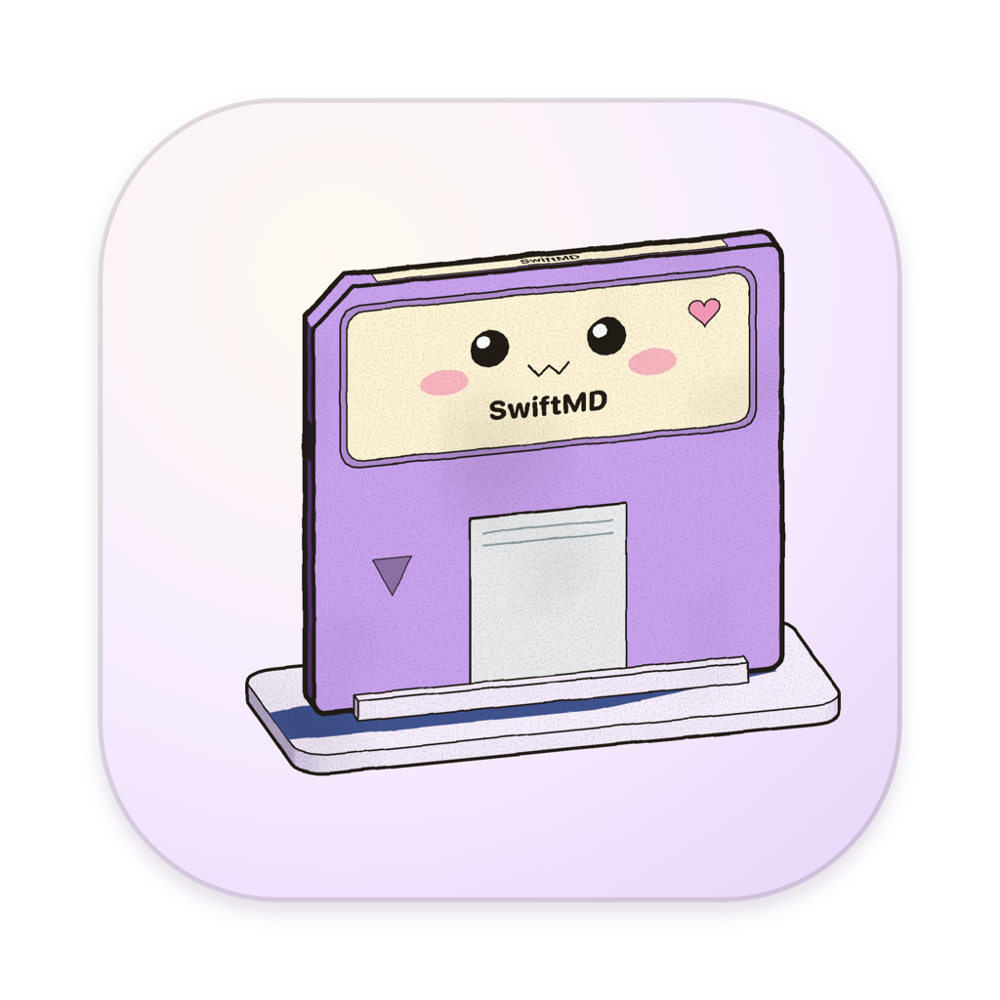

<p align="center"></p>

# SwiftMD

A native Mac app for NetMD MiniDisc recorders: see what's on a disc, rename and rearrange tracks,
send music to it, and **back your MiniDiscs up to your Mac**, one disc at a time or a whole
collection with Archive Mode.

SwiftMD is a Swift port of [Web MiniDisc Pro](https://github.com/asivery/webminidisc) /
[ElectronWMD](https://github.com/asivery/ElectronWMD) and the projects behind them (see
[Credits](#credits)). It needs no drivers or extra software.

> **Beta, use at your own risk.** SwiftMD has been tested on a handful of Sony portables (listed
> below). It was written to be careful with your player and your recordings (see
> [Safety](#safety)), but MiniDisc hardware is old and every unit is different. Back up anything
> irreplaceable before editing or erasing it, and if something looks wrong, unplug the player:
> SwiftMD's changes to the player only ever live in its memory and are gone when it restarts.

## Download

Get the latest `SwiftMD-x.y.z.zip` from [Releases](../../releases), unzip it and drag
**SwiftMD** to your Applications folder. It runs on macOS 14 (Sonoma) or later, on Apple silicon
and Intel Macs.

SwiftMD isn't signed with an Apple Developer ID yet, so the first time you open it macOS says it
can't check it for malicious software. To open it anyway (only needed once):

- **macOS 15 (Sequoia) and later:** open SwiftMD, click **Done** on the warning, then go to
  **System Settings → Privacy & Security**, scroll down and click **Open Anyway** next to SwiftMD.
- **macOS 14 (Sonoma):** right-click SwiftMD in Applications, choose **Open**, then **Open** again.

The source code is all here if you'd rather build it yourself (see [Building](#building-from-source)).

Plug in your recorder (a USB hub is fine), open SwiftMD and click **Connect**. Only one app can
use the recorder at a time, so quit Web MiniDisc Pro / ElectronWMD first.

## What it does

- **Disc and tracks:** titles (including Japanese), groups, lengths, SP/LP2/LP4, space left.
- **Editing:** rename the disc, tracks and groups, group and move tracks, delete tracks, erase the disc.
- **Playback:** play, pause, stop, skip, eject.
- **Send music:** drag in audio files and record them as SP, LP2 or LP4.
- **Back up tracks** (Sony Type-R and Type-S portables): copies tracks bit-for-bit as `.aea`
  (SP) or `.wav` (LP2/LP4, ATRAC3 inside), plus a playable `.m4a` of each in a `Playable` folder.
  On Type-S players (e.g. MZ-N910) backups use a faster transfer, about 6 times faster.
- **Archive Mode:** for whole collections. Turn it on, choose a folder, and every disc you insert
  is backed up into its own folder with a `disc.json` describing it (titles, groups, recording
  dates) and a copy of its table of contents. Discs already in the archive are recognised and
  skipped. Optional: **Erase when done** (see below), and on decks **Eject when done**.
- **Erase Mode:** for blanking a stack of discs you've already archived. Every disc you insert is
  looked up in your archive and erased only if it's there (see below); anything else is left alone.

### Erasing archived discs

For people who want their discs blank again after archiving, with **Erase when done** in Archive
Mode or with **Erase Mode**. Both are off unless you turn them on, and ask you to confirm. A disc is
only erased when:

- every track was copied completely and its playable copy decoded without a single error,
- every file of the backup is in the archive folder and isn't empty, and
- the disc in the player is still the one that was archived (its table of contents is read again
  and compared).

Write-protected discs are never erased. Erasing can't be undone.

**On portables, unplug the USB cable after each erase.** Portable recorders keep changes in
memory and only write them to the disc when the USB cable is unplugged (the display says
"TOC Edit" while it writes). Keep the player on power or a good battery while it writes, then swap
discs and plug it back in: SwiftMD reconnects by itself. If "TOC Edit" keeps looping, the player's
recording may be weak or its battery low: take the battery out to stop it, and erase on another
recorder.

## Tested players

| Player | Firmware | Tested |
|---|---|---|
| Sony MZ-N910 | Type-S S1.600 | Reading, editing, fast backups, Archive Mode |
| Sony MZ-N505 | Type-R R1.400 | Backups (LP2), erasing |
| Sony MZ-N707 | Type-R R1.300 | Reading, editing, sending music |

Other Sony NetMD portables and decks should work for reading, editing and sending music, as they
do in Web MiniDisc Pro. Backups need a Sony Type-R or Type-S portable. Hi-MD recorders aren't
supported yet. If you try SwiftMD on another player, please open an issue and say how it went.

## Safety

Backing up uses the player's factory (service) mode, as Web MiniDisc Pro does. SwiftMD keeps to
these rules:

- **Nothing permanent.** Every change SwiftMD makes to the player is in its working memory (RAM)
  and disappears when it restarts. It never writes the player's EEPROM or flash.
- **The player's own fixes stay.** Players load small firmware fixes from Sony into patch slots.
  SwiftMD only uses slots that are switched off and puts back anything it moved. (Web MiniDisc
  Pro doesn't check this.)
- **Only firmware it knows.** Code that runs on the player only exists for firmware versions it
  was checked against; on anything else SwiftMD refuses before changing anything. Backups have
  been tried on real players with S1.600 and R1.400; on other firmware SwiftMD asks first.
- **Only Sony NetMD recorders.** Backups are refused on other brands and on Hi-MD recorders
  before anything is sent.
- **If in doubt, stop.** If SwiftMD can't take its code back out of the player, it doesn't try
  anything else: it asks you to unplug the player for a few seconds, which undoes everything.
- **Reading doesn't write.** Showing a disc only sends read commands (a test checks every one).


## Building from source

Requires macOS 14 and Xcode 16 or later.

```bash
swift build
swift run SwiftMD     # the app
swift test
Tools/package-app.sh  # builds dist/SwiftMD.app (see docs/releasing.md for signing)
```

`swift run netmdcli` is a command-line tool for developers (with no options it only reads the
disc; the options are in `Sources/netmdcli/main.swift`). Set `SWIFTMD_TRACE=1` to log
every command sent to the recorder.

## Credits

SwiftMD is a port of other people's work, and is licensed under the GPL-2.0 like the originals:

- [netmd-js](https://github.com/cybercase/netmd-js) by Stefano Brilli and Asivery: the NetMD protocol.
- [Web MiniDisc Pro](https://github.com/asivery/webminidisc) and [ElectronWMD](https://github.com/asivery/ElectronWMD) by Asivery.
- [netmd-exploits](https://github.com/asivery/netmd-exploits) and [netmd-tocmanip](https://github.com/asivery/netmd-tocmanip) by Asivery, with Sir68k's fast bulk transfers: factory mode and backups.
- [linux-minidisc](https://github.com/linux-minidisc/linux-minidisc): the original NetMD reverse engineering.
- [atracdenc](https://github.com/dcherednik/atracdenc) by Daniil Cherednik (LGPL-2.1): the ATRAC3 encoder for LP2/LP4, in `Sources/CAtracDEnc`.
- [FFmpeg](https://ffmpeg.org) (LGPL-2.1+): the ATRAC1 and ATRAC3 decoders, ported to standalone C in `Sources/CAtrac3Dec` (Maxim Poliakovski, Benjamin Larsson).
- The icon was drawn with Colorfigures (`Tools/icon`).

Ported files keep a header naming the file they come from. MiniDisc and Walkman are trademarks of
Sony; SwiftMD isn't made or endorsed by Sony.

## License

[GPL-2.0](LICENSE).
